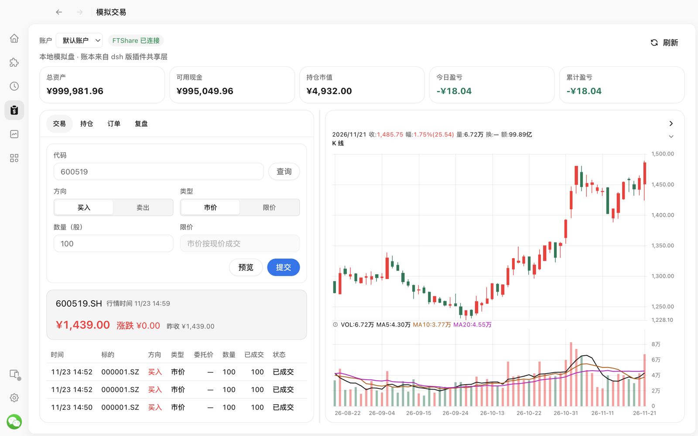
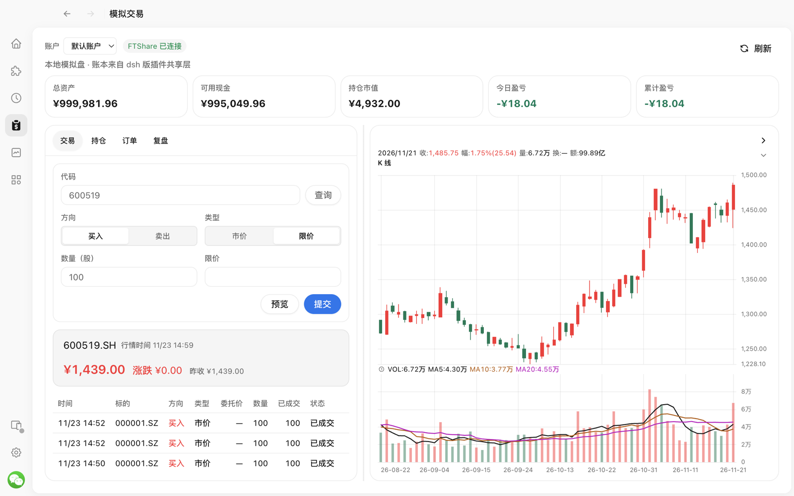

# 模拟交易（FtAi Desktop 插件）

本地事件账本的 A 股 / 期货模拟交易插件：交易、持仓、订单、复盘，以及给模型的 `paper_*` 工具。
宿主一半跑在 FtAi Desktop 的插件进程里，界面一半是 React 视图；数据经 FTShare 短期令牌接入。

> 包名暂用 `plugin-paper-trading`（占位，未发布）。正式 npm scope 待与 FtAi 协商，候选
> `@ftai/plugin-paper-trading` 或 `@ftai-plugin/paper-trading`；定名后包名与代码里的
> `/types`、`/remote` 引用会一起改，发布第一版前不要安装公开版本。

## 当前状态（0.6.0）

- 业务层与 dsh 版插件 **v0.8.0 同源**：`core/`、`contract/`、`store/`、`service/`、`data/`、
  `agent/` 按 tag 原样同步（见 `SHARED.md`）；事件账本、多账户、股票与期货两套服务。
- 宿主一半：Remote 命名空间 `ftaiPaperTrading`，对界面暴露与 dsh 面板一致的
  `rpc(endpoint, payload, account)`；18 个 `paper_*` / `paper_ledger` / `paper_futures_*` 工具注册。
- 账本位置：`ctx.localInstall.dataDir/paper-trading/<account>/events.jsonl`。
- 数据：声明能力 `ftshare.token`，用户点「连接 FTShare 数据」后取短期令牌，以
  `Authorization: Bearer` 访问 FTShare 网关；插件不保存令牌，也不接触 API Key。
- 界面：账户切换、交易/持仓/订单/复盘四个标签；五张统计卡同排；交易表单方向/类型共用分段控件、
  控件统一 32px；右栏日 K 用应用公开的 `StockChart`（可拖宽 220–720px、可折叠）；打开自动加载
  默认标的 `600519`；复盘用账本逐日快照画权益曲线。
- 面板 e2e：真实应用里 10 步全过（布局 / 默认行情 / 查询 / 预览 / 下单 / 持仓订单复盘 /
  非法代码 / K 线拖动折叠），页面错误 0。

## 界面截图





截图是 `tests/e2e/ui-smoke.mjs` 跑出来的界面手工挑选、缩放后提交的文档图；测试运行产物不提交，
说明见 `docs/screenshots/README.md`。

## 目录

```
src/
  core/ contract/ store/ service/ data/ agent/   # 与 dsh 版同步的共享层
  platform/ftshare-client.ts                     # ctx.ftshare 令牌 → MCP Bearer 客户端
  index.ts                                       # 宿主一半：装配、Remote、工具、调度
  client/                                        # 界面一半（React）
  types.ts                                       # 边界类型（再导出契约）
tests/e2e/                                       # 面板 CDP 测试
scripts/sync-shared.mjs                          # 从 dsh 版插件同步共享层
shared-manifest.json                             # 同步来源 tag/commit/逐文件 sha256
```

## 构建

```bash
pnpm install
pnpm build            # tsc → ftai-plugin-remote → tsc client → vite build
```

依赖已改为从 npm 安装的 `@ftai/plugin-sdk@^2.5.0`，不再依赖桌面端源码；构建产物在 `lib/`。

## 本机试装

```bash
# 1) 本机 npm 源（首次会下载 verdaccio）
npx verdaccio --listen 4873

# 2) 发布到本机源
pnpm build
pnpm publish --registry http://127.0.0.1:4873 --no-git-checks

# 3) 带本机源启动已安装的 FtAi Desktop（隔离走查目录）
FTAI_PLUGIN_REGISTRY=http://127.0.0.1:4873 \
FTAI_HOST_HOME=$HOME/ftai-walkthrough/paper-trading/host \
FTAI_DEV_FILE_CREDENTIALS=1 \
  "/Applications/FtAi Desktop.app/Contents/MacOS/FtAi Desktop" \
  --user-data-dir=$HOME/ftai-walkthrough/paper-trading/userData \
  --remote-debugging-port=0

# 4) 应用「插件」页 → 添加 → 按包名安装 plugin-paper-trading@0.6.0
```

首次打开面板时授权 FTShare 数据（仅允许本次 / 始终允许此插件 / 拒绝）。

## 发布到 npm

- 先确定 scope 并改 `package.json` 的 `name`（同时全仓替换 `/types`、`/remote` 的引用）。
- `pnpm publish --access public`；新版本有 24 小时冷却，需要立刻安装时写 `包名@版本`。
- 公开远端发布不在本机自动化范围内，需要人工确认后执行。

## 面板 e2e

```bash
node tests/e2e/ui-smoke.mjs --walkthrough ~/ftai-walkthrough/paper-trading
```

应用需带调试口启动、已登录并授权 FTShare；测试会向走查账本真实下单。详见 `tests/e2e/README.md`。

## 后续

1. 补多账户切换之外的对比页、期货页面与批量下单 UI。
2. 复盘曲线目前只有日快照单点时会退化，需要补空态；「全部」区间的 i18n key 也要修。
3. 共享层跟版：`node scripts/sync-shared.mjs --tag <dsh 版新 tag>` 后重新构建。
